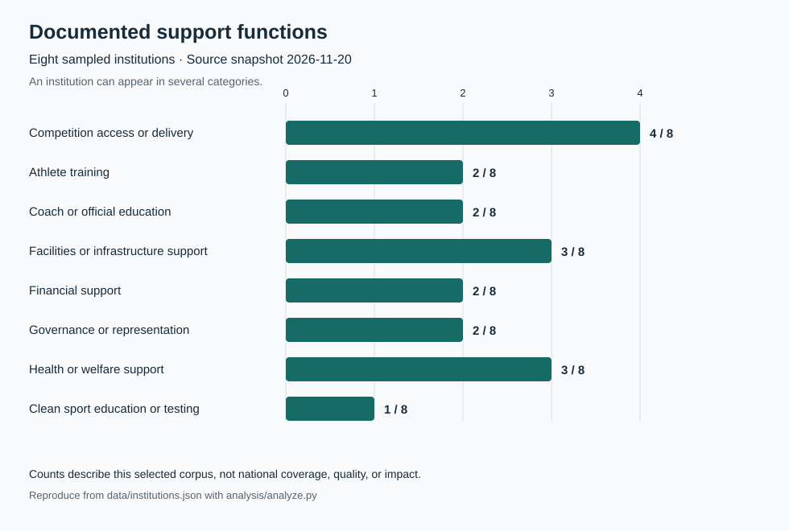

# Institutional support in Jamaican athletics

## A public source research extension

What kinds of institutional support are documented around the transition from school athletics toward higher-level competition in Jamaica? This project answers a bounded version of that question by mapping the stated functions of eight institutions. It turns official web descriptions into a transparent evidence matrix and reproducible descriptive analysis.

**The result is a map of documented support functions.** It does not track individual athletes through a development pathway or estimate which institution produces the best outcomes. The sample contains 11 primary-source pages and 19 institution-function assignments across eight coding categories. [View the reproduced results](results/summary.md).

## My role and the original context

**UVA McIntire · USOAR Research Assistant · 2023–2024**

My original research-assistant role with Professor Kisha Lashley focused on Jamaica's track and field ecosystem. This portfolio extension returns to that subject through a narrower public-source question and documents the method from source selection to coded observations.

The present source register, analysis code, and findings were created for the portfolio in 2026. They show how I would make a research question and its evidence understandable to another reader; they do not reconstruct the original study's unpublished work.

[Portfolio overview](https://zianabennett.github.io/#work) · [Experience and leadership](https://zianabennett.github.io/#experience)

## What the evidence shows

**Competition is one part of the support landscape.** Four sampled institutions have documented competition access or delivery. Other coded functions include coach education, facilities, welfare, and clean sport. Their presence suggests several kinds of support to examine in a future athlete-journey study; it does not establish a coordinated pipeline. [Evidence matrix](results/evidence-matrix.md).

**The sampled tertiary institutions have different documented roles.** UTech and UWI Mona describe athlete programmes and supporting services; G C Foster's included page concerns coach development. The coding reflects the pages reviewed rather than a complete inventory of each institution. [S04](sources/source-register.md#s04), [S05](sources/source-register.md#s05), [S06](sources/source-register.md#s06).

**Some support extends across sports and stages.** JADCO's 2026 school workshops connect clean-sport education to junior athletes. SDF describes infrastructure and welfare mechanisms across sports. These are relevant support functions, although the sources do not establish track-and-field-specific service coverage. [S08](sources/source-register.md#s08), [S09](sources/source-register.md#s09).

**National administration and Olympic representation are separately documented.** JAAA describes its athletics governing role, while JOA describes Olympic representation and scholarship support. Their inclusion identifies distinct institutional functions, not a verified referral or selection process between them. [S03](sources/source-register.md#s03), [S10](sources/source-register.md#s10), [S11](sources/source-register.md#s11).



## Explore the work

| File | Purpose |
| --- | --- |
| [Findings](findings.md) | Interpretations, practical research implications, and limits |
| [Method](method.md) | Sampling, coding rules, and what the analysis can establish |
| [Evidence matrix](results/evidence-matrix.md) | Each institution-function assignment and its supporting sources |
| [Source register](sources/source-register.md) | Exact official URLs, access dates, and source limitations |
| [Input data](data/institutions.json) | Structured observations used by the analysis |
| [Analysis script](analysis/analyze.py) | Standard-library Python that validates and reproduces outputs |

## Reproduce the analysis

The outputs above can be read directly in GitHub. To regenerate them locally with Python 3, download the repository, open a terminal in its folder, and run:

```bash
python3 analysis/analyze.py
python3 analysis/analyze.py --check
```

No packages or network access are required. The second command checks that the saved outputs exactly match the inputs. It does not audit the truth of institutional statements.

## Scope and next research decision

The institutions were selected to cover different functions, not sampled randomly. The pages were accessed on 20 November 2026; several are undated, and UWI's page retains an older availability notice. Counts describe this corpus only. The next useful study would document athletes' actual access to services and transitions between providers, using consented interviews or appropriate administrative records. That would test continuity of support, which this institutional map cannot establish.
